# Padel Booking

[](https://github.com/Alosh9933-collaps/padel-booking-api/actions/workflows/ci.yml)

A full-stack system for running a padel club: court bookings, a buffet on the same bill, prepaid packages, cash-up and shifts, an owner dashboard, and an online booking page where players pay up front and staff are notified at once. It works in English, Arabic (right to left) and Russian.

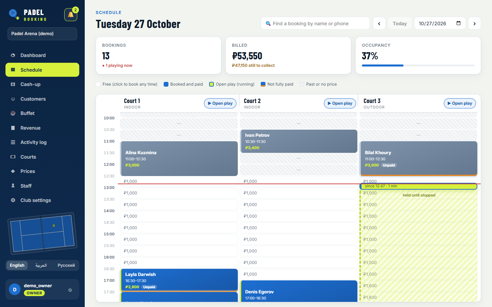

It is designed around the daily work of a real club in Russia: walk-in players who want open play billed by the minute, regulars who pay with a prepaid balance, a front desk that must cash up at night, and an owner who wants to know which hours to put on discount.

## What it does

**Front desk**
- Day schedule for all courts. Book any free minute. Drag a booking to move it, also to another court, or drag its edge to make it longer or shorter. The new price is shown for confirmation before saving.
- Open play: start a game with no end time. The court is held until closing, and the player pays for the exact minutes played.
- Weekly series (for example "the Tuesday group") in one step. Cancel one game or all the following ones.
- One bill per booking: court time plus buffet items, a discount, split payments (cash, card, transfer, prepaid balance), a change calculator for cash, and refunds.
- Receipts sent by WhatsApp or Telegram, or printed.
- Search any booking by name or phone, and counter sales without a booking.

**Customers and loyalty**
- Customers are recognised by phone number, with visits, no-shows, money spent and last visit.
- Categories (Regular, Coach and so on) with their own discount, plus first-visit and every-Nth-visit rewards. Discounts never apply themselves: the bill suggests them and staff apply them with one click.
- Prepaid packages (pay ₽10,000, get ₽11,500 of credit) and a full history of each customer's balance.

**Money and control**
- Daily cash-up by payment method, and shifts with an opening float and the cash expected in the drawer.
- An activity log of who did what: payments, refunds, discounts, moved and cancelled bookings, top-ups.
- Roles: owner, manager and receptionist. Prices, courts, staff and reports are for owners and managers; reception works the desk.
- Owner dashboard: this month against the same days of last month, a heatmap of busy and quiet hours over 8 weeks, best customers, and the last 6 months.

**Players online**
- A public page per club (`/book/<club>`), no account needed. Players choose a day, any length from 60 minutes in steps of 10, and a free time with its exact price. The club sets how many days ahead and the cancellation window. Each phone number can hold at most 3 upcoming online bookings, and the endpoints are rate limited.
- Prepayment: an online booking is only confirmed once it is paid (YooKassa, or a demo payment page for testing). The club chooses how much is paid up front.
  - While the player pays, the court is held for 15 minutes. An unpaid hold frees itself.
  - A payment that arrives too late is refunded automatically, and so is the prepayment when a player cancels in time.
- Each booking gets a private link to view, pay or cancel it.
- Staff see every new online booking at once:
  - In the admin site, as a pop-up with the details, a sound and a bell with an unread count. It also shows as a system notification when the tab is in the background.
  - In their Telegram group. Players who open the bot link get a confirmation and a reminder before the game.

## Screenshots

| | |
|---|---|
| 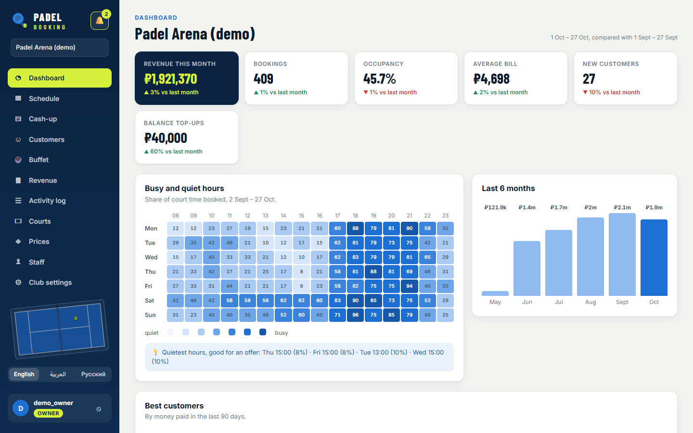 | 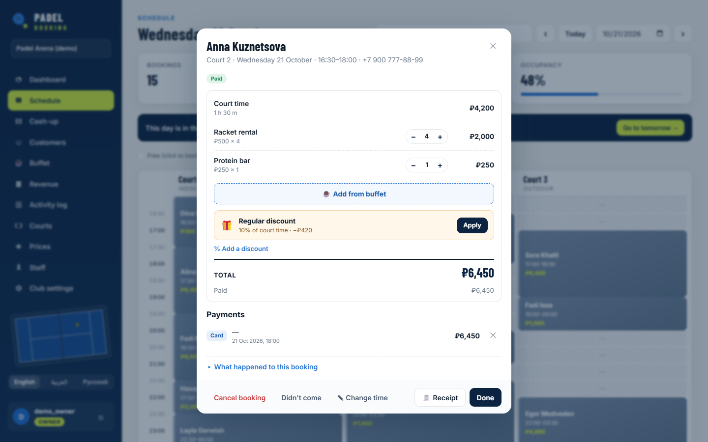 |
| Owner dashboard: month against month, busy and quiet hours | A bill: buffet items, a one-click loyalty offer, payments |
| 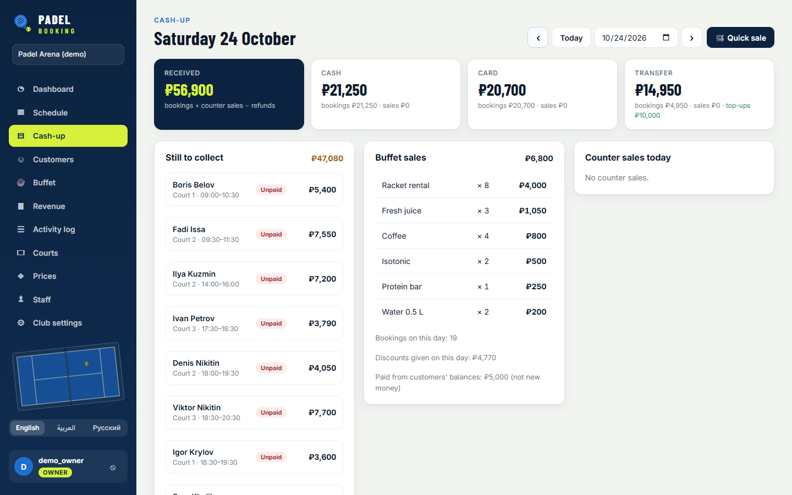 | 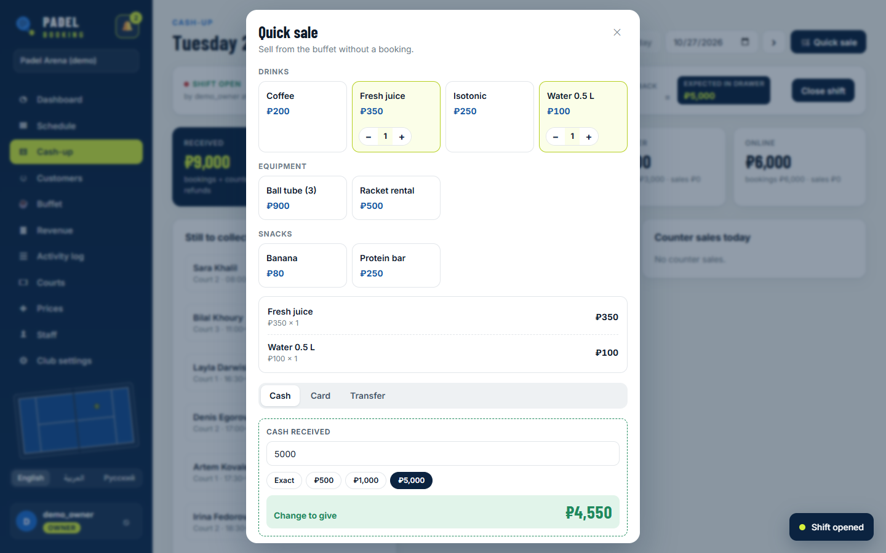 |
| Daily cash-up by method | Counter sale with the change to give |
| 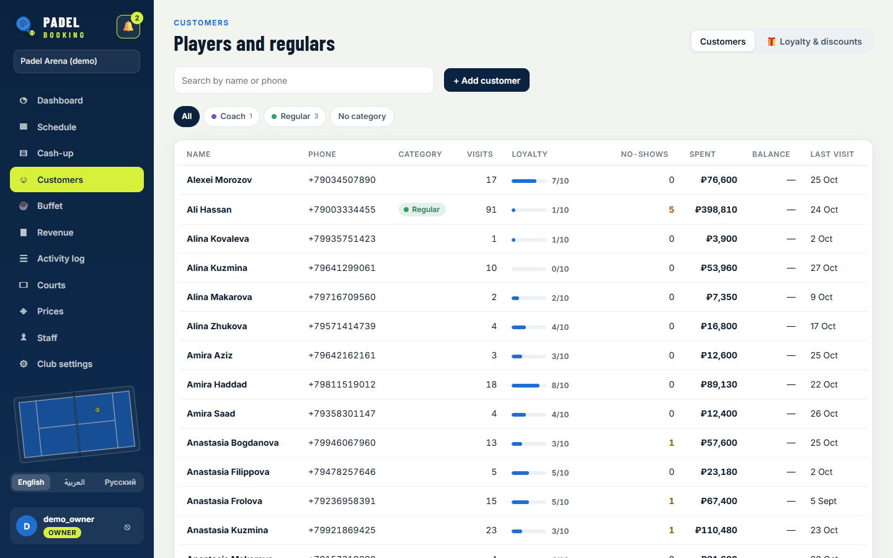 | 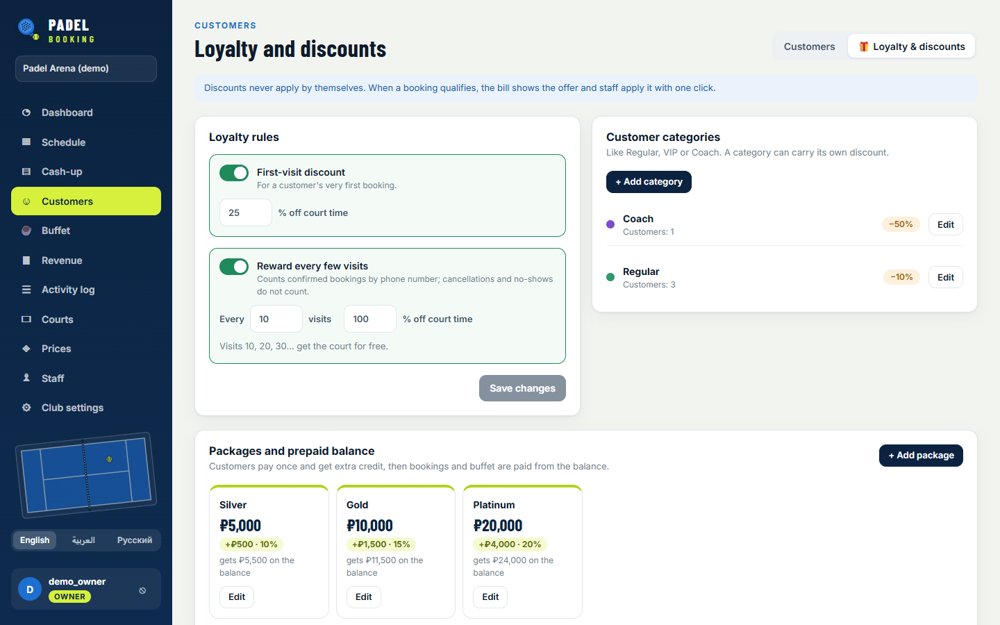 |
| Customers with visits, loyalty progress and balances | Loyalty rules, categories and prepaid packages |
| 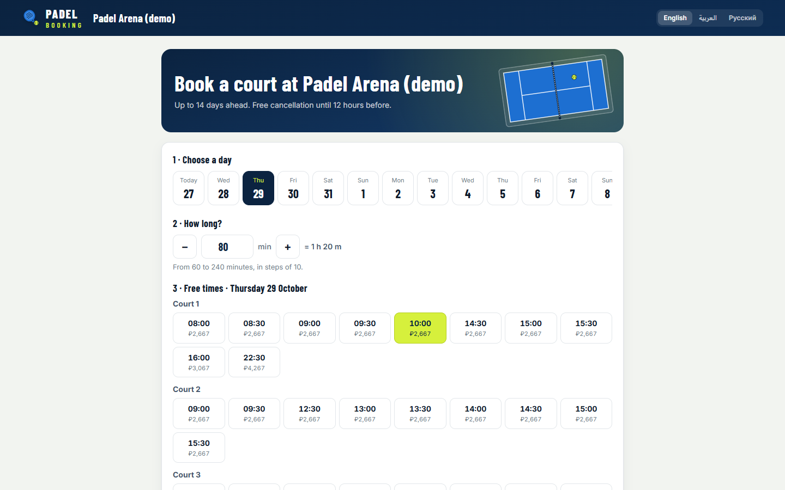 | 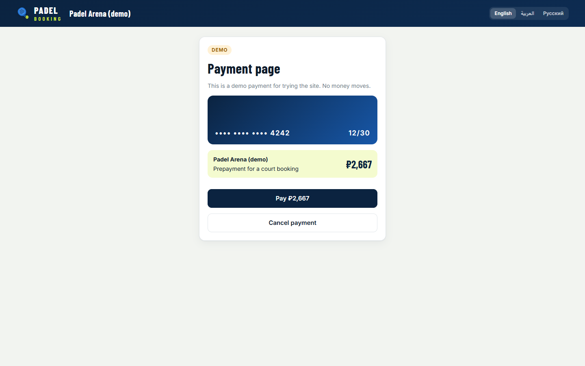 |
| Public booking page: any length, exact prices | Prepayment (the demo provider; YooKassa in production) |
| 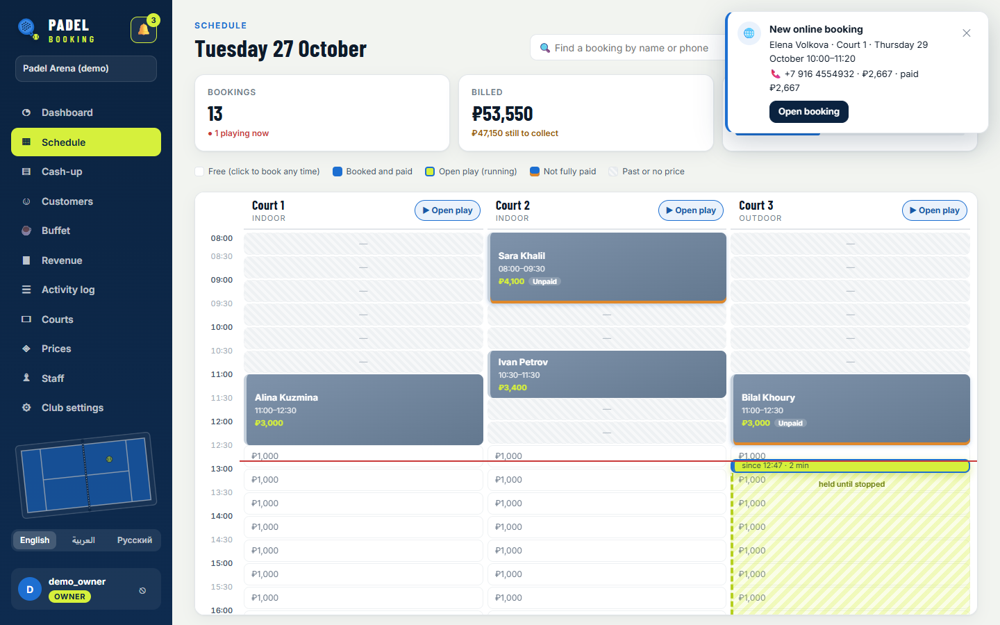 | 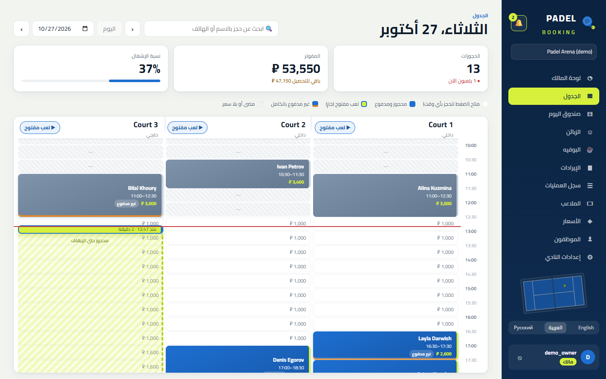 |
| Staff see a paid online booking at once | The whole app in Arabic, right to left |

<p align="center">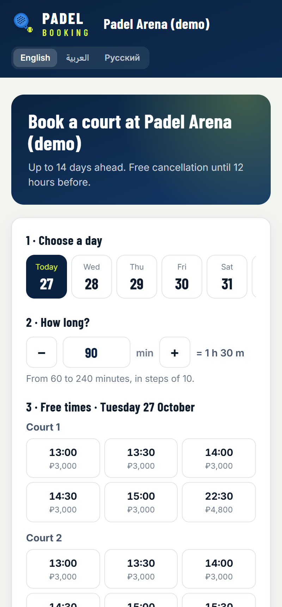</p>

## Engineering notes

- **Double bookings are impossible at the database level.** A PostgreSQL exclusion constraint forbids two confirmed bookings whose time ranges overlap on the same court. A per-court advisory lock makes concurrent requests wait their turn, so the loser gets a clean "slot taken" answer (HTTP 409) instead of a database error. Moving a booking to another court locks both courts in a fixed order, so two moves cannot deadlock.
- **Money is `Decimal` everywhere, and prices are frozen on the booking.** Changing the price list never changes past bills. Prices are worked out minute by minute across hourly rules (weekday, evening, weekend), so a game from 16:30 to 18:00 is charged at both rates.
- **Online prepayment cannot charge twice or lose money:**
  - Every step (start, paid, not paid, hold ran out) can safely run again. Each one locks the payment row, then the booking row.
  - The YooKassa webhook body is never trusted: the status is always asked from YooKassa itself.
  - Payments and refunds carry idempotence keys.
  - Unpaid holds are released by a cron command, and also whenever someone looks at the schedule or the booking page.
- **Free times for any length are worked out on the server**, priced by the minute. Start times include the gap right after an odd-length game, not just the half-hour grid.
- **The prepaid balance is a ledger, not a number.** Every top-up, payment, sale and refund is a row. Spending locks the customer row (`SELECT … FOR UPDATE`), so two desks cannot spend the same credit. Cash-up counts a top-up as new money and a balance payment as not.
- **Every query is scoped to the user's clubs** through one helper. It also avoids the Django trap where two chained `filter()` calls on memberships could let a receptionist pass as a manager.
- **The public API is hardened:** no login, but throttled per IP, with an explicit consent checkbox and unguessable UUID links. An invalid link returns 404 and never matches staff bookings, which have no link.
- **Errors carry stable codes** (`slot_unavailable`, `balance_too_low`, `too_late_to_cancel` and so on), and the frontend translates them into all three languages.
- **Right to left done properly:** logical CSS properties, and Unicode isolates for times, phone numbers and minus signs inside Arabic text, so "18:30–20:00" never comes out reversed.
- **Query performance:** the customer list builds visits, money spent and balance with per-customer subqueries. On 2,000 bookings that took the query from 1.1 s to 20 ms.
- **Telegram with no extra infrastructure:** a long-polling bot as a management command, and messages sent only after the database transaction commits.
- **Tests:** 174 backend tests on PostgreSQL, run by GitHub Actions on every push together with the frontend build, a check for missing migrations and a check of the API schema. They cover overlaps and concurrent requests, permissions per role, money edge cases, the wallet, the dashboard, the public API, and prepayment, including late payments, refunds and YooKassa with mocked network calls.

## Tech stack

- **Backend:** Python 3.14, Django 6.0, Django REST Framework, SimpleJWT, drf-spectacular (OpenAPI docs), PostgreSQL 17
- **Frontend:** React 19, TypeScript, React Router, Vite. No UI kit: hand-written CSS and SVG artwork.

## Run it locally

You need Python 3.14, Node 20 or newer, and Docker (for PostgreSQL).

```bash
git clone https://github.com/Alosh9933-collaps/padel-booking-api.git
cd padel-booking-api
docker compose up -d                 # PostgreSQL on localhost:5433

python -m venv .venv
source .venv/bin/activate            # Windows: .venv\Scripts\activate
pip install -r requirements.txt
python manage.py migrate
python manage.py seed_demo           # a demo club with five months of history (about a minute)
python manage.py runserver           # API on http://127.0.0.1:8000

cd frontend
npm install
npm run dev                          # app on http://localhost:5173
```

- Sign in as `demo_owner`, `demo_manager` or `demo_desk`. The password is `padel-demo-2026`.
- Public booking page: http://localhost:5173/book/padel-arena-demo
- API docs (Swagger): http://127.0.0.1:8000/api/docs/
- Tests: `python manage.py test` (the database must be running)

**Showing it in person (Windows):** double-click `demo.cmd`.
- It starts the database, the API and the website for the demo club, which has its own database and gets fresh dates once a day.
- It opens the admin site and prints the address phones on the same Wi-Fi can use.
- In Club settings, the booking page link has a QR code button, so customers can book from their own phones while the staff side gets the notification.
- Press Enter in the window to stop. `demo.cmd -Reset` rebuilds the demo club; `-Detach` and `-Stop` run it in the background.

Online prepayment uses a demo payment page in development, so the whole flow can be tried without real money. For real payments:
- Set `YOOKASSA_SHOP_ID`, `YOOKASSA_SECRET_KEY` and `PUBLIC_SITE_URL`.
- Point the YooKassa webhook to `/api/public/payments/yookassa/`.
- Run `python manage.py release_holds` every minute.

Telegram is optional. Set `TELEGRAM_BOT_TOKEN` and `TELEGRAM_BOT_USERNAME`, run `python manage.py telegram_bot`, and run `python manage.py send_reminders` every few minutes.

Production settings come from the environment variables listed in [.env.example](.env.example).

## Project structure

```
api/        REST API: staff endpoints, public booking API, dashboard, and the tests
bookings/   bookings, pricing, payments, refunds, discounts
buffet/     products, items on a bill, counter sales
cashdesk/   shifts and the activity log
clubs/      clubs, courts, price rules, staff roles, customers, the demo seeder
wallet/     prepaid packages and the balance ledger
payments/   online prepayment: YooKassa and the demo provider, holds, refunds
notify/     staff notifications, Telegram messages, the bot and reminders
frontend/   React app: the staff app and the public booking page
```

## Next steps

- Deployment: Docker image, nginx and HTTPS
- Fiscal receipts (54-FZ) through YooKassa
- One database per club, to offer it to other clubs
